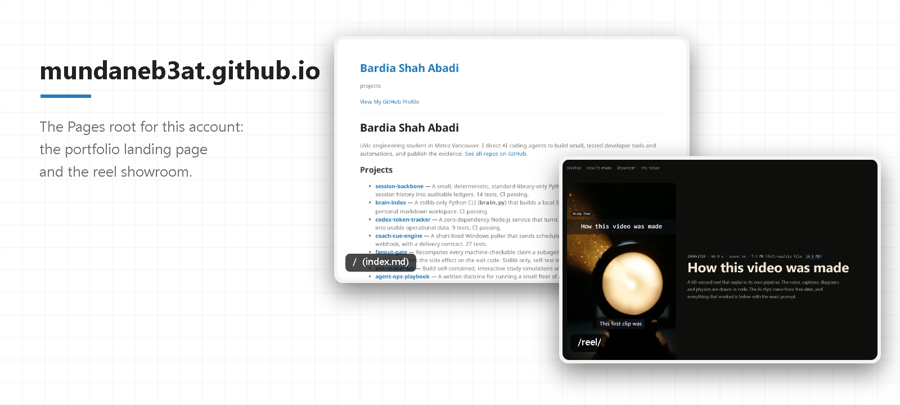
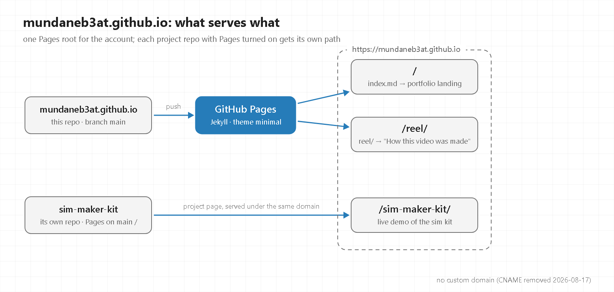

# mundaneb3at.github.io

- **What:** the GitHub Pages root for this account: a portfolio landing page and the [reel showroom](https://mundaneb3at.github.io/reel/).
- **How:** Pages builds `index.md` with Jekyll (theme minimal); `reel/` is served as static files; project repos with Pages on get their own path.
- **Run:** visit <https://mundaneb3at.github.io/>, or edit `index.md` and push to `main`.

GitHub Pages root for the `mundaneb3at` GitHub account. The live site (a portfolio landing page listing the account's projects) is generated from `index.md` — edit that file, not this README, to change what's served. No custom domain is configured: a `CNAME` file pointing to `stosnia.me` was removed 2026-08-17 because that domain had no server listening on it and was 301-redirecting every Pages URL on this account (including project demo pages like `https://mundaneb3at.github.io/sim-maker-kit/`) to a dead endpoint — re-add a `CNAME` only once a real destination is confirmed live with `curl -sI`.

## License

MIT — see [LICENSE](LICENSE).
